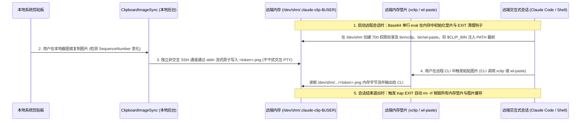

# ssh4work

> **零第三方依赖 · 100% 纯 SSH 零远端侵入 · 多服务器并发工作台 · 纯内存剪贴板图片直通粘贴 · 远程开发与 AI CLI 插件化管理 TUI**
>
> 特别鸣谢 **[LINUX DO 社区 (https://linux.do)](https://linux.do)** 佬友们的灵感碰撞与技术分享！

---

## 目录

- [项目简介](#项目简介)
- [核心特性](#核心特性)
- [核心技术原理深度解析](#核心技术原理深度解析)
  - [1. 纯 SSH 零侵入架构与纯内存脚本执行](#1-纯-ssh-零侵入架构与纯内存脚本执行)
  - [2. 纯 SSH + 纯内存 (`/dev/shm`) 剪贴板图片与文本直通粘贴](#2-纯-ssh--纯内存-devshm-剪贴板图片与文本直通粘贴)
  - [3. 零依赖 TUI 渲染引擎与内嵌多标签 VT100 虚拟终端](#3-零依赖-tui-渲染引擎与内嵌多标签-vt100-虚拟终端)
- [项目目录结构](#项目目录结构)
- [安装与运行](#安装与运行)
- [插件系统与扩展开发](#插件系统与扩展开发)
- [快捷键与触控操作指南](#快捷键与触控操作指南)
- [配置与私钥安全说明](#配置与私钥安全说明)
- [鸣谢 (Acknowledgements)](#鸣谢-acknowledgements)
- [开源协议](#开源协议)

---

## 项目简介

对于同时维护多台 VPS / 云服务器的开发者而言，在多台远程机器之间切换目录、管理终端会话、粘贴本地截图到远程 CLI 工具（如 Claude Code / Codex 等）、以及查阅各台服务器上的 AI 辅助开发历史与 Token 消耗，往往需要繁琐的配置或在远端部署各种常驻 Agent。

本项目是一个**完全基于 Node.js 原生内置模块（零第三方 `npm` 依赖）**构建的终端图形界面（TUI）多服务器远程工作台：

1. **纯粹依靠本机 OpenSSH (`ssh`)**：无需在远端 VPS 安装任何常驻守护进程或 Agent，所有远程探针与管理脚本均通过 SSH 标准输入管道（`stdin`）在远端内存中即时解释执行，**不在远端硬盘留下任何脚本文件**。
2. **突破纯 SSH 无法直接粘贴本地剪贴板图片的痛点**：独创基于远端内存文件系统（`/dev/shm`）与内存动态 `xclip` / `wl-paste` 垫片（Shim）的纯 SSH 图片剪贴板同步机制，无需配置繁琐的 X11 Forwarding，即可在远程终端中直接粘贴本地截图。
3. **面向多服务器选手与远程开发**：内置轻量级 VT100/ANSI 虚拟终端（`VirtualTerminal`），支持在单个 TUI 窗口内同时开启并毫秒级切换多台服务器的多个交互式终端标签页，并通过插件化架构原生集成主流远程开发 AI Agent 管理能力。

---

## 核心特性

- **🖥️ 多服务器连接与特权管理**
  - 支持保存多台 VPS 连接配置（主机、端口、用户、私钥路径、可选密码登录、`ProxyJump -J` 跳板机、额外 SSH 参数、前置环境命令 `preCommand`、自定义快捷指令）。
  - 支持从本机 `~/.ssh/config` 一键解析并导入已有 Host。
  - **私钥智能扫描与剪贴板一键落盘**：自动扫描项目目录内的私钥候选文件供下拉选择；支持直接从系统剪贴板粘贴私钥文本，自动规范化为 LF 换行并收紧文件权限（POSIX `chmod 600` / Windows `icacls` 仅当前用户可读）。
  - **灵活的特权模式（Privilege Mode）**：支持每台服务器配置 `none`、`sudo`（支持免密 `sudo -n` 或自动填充提权密码：非交互命令经 SSH 标准输入传递，交互终端由 TUI 应答 sudo 提示，密码不会出现在本地或远端的进程命令行中）与 `root` 直连模式，远程目录浏览支持一键切换 `[sudo 提权]`。
- **🗂️ 远程目录浏览与快捷指令工作流**
  - 可视化浏览远程文件系统、新建/重命名文件夹、显隐隐藏目录、路径跳转、收藏常用工作目录（`★`）并自动记忆每台服务器上次访问的位置。
  - 支持为每台服务器配置专属**快捷指令（Quick Commands）**（如 `docker ps`、`htop`、启动开发服务等），支持横屏双栏与竖屏自适应布局。
- **📑 内嵌多服务器多标签页终端 (`VirtualTerminal`)**
  - 在同一终端窗口内同时保持多台服务器的多个 SSH 会话标签（例如同时挂着服务器 A 的 Claude Code、服务器 A 的 Root Shell 和服务器 B 的日志监控），点击顶部标签栏即可无缝切换。
  - 支持 2000 行历史回滚缓冲（Scrollback）、终端尺寸变化时自动通知远端 PTY（`stty rows cols`）、`OSC 52` 远程剪贴板穿透，以及 TUI 界面鼠标划词自动复制到本地剪贴板。
- **📋 纯 SSH 内存级图片剪贴板直通**
  - 在本地截图或复制图片文件后，后台通过独立 SSH 通道自动将 PNG 数据推送至 VPS 内存（`/dev/shm`），并在远程会话内存中挂载 `xclip` 与 `wl-paste` 虚拟垫片，让运行在无头（Headless）VPS 上的 CLI 工具也能无缝读取本地剪贴板图片。
- **🧩 插件化远程开发与多 AI Agent 深度管理**
  - 内置 5 款开箱即用的远程开发 Agent 插件（可按全局或按单台服务器独立启用/禁用），并支持通过本地 `plugin.json` 加载自定义插件：
    - **Claude Code (`claude-code`)**：全文搜索/预览/恢复（`--resume`）/分叉（`--fork-session`）远程会话；管理分项目 `MEMORY.md`、全局 `CLAUDE.md`、远程 Skills（支持从 Git 仓库/URL/文本一键安装）与 MCP 服务器；内置 **Token 与成本统计面板**（支持精确到秒的本地时区过滤、缓存命中率、TTFT 首字延迟、生成速率 `tok/s`、按小时/按天/按模型/按请求路由聚合，以及模型偷换差异高亮标红）。
    - **Codex CLI (`codex-cli`)**：扫描 `~/.codex/sessions`，支持会话检索、预览、恢复，以及全局 `AGENTS.md`、Skills 与 `config.toml` MCP 管理。
    - **Antigravity CLI (`antigravity-cli`)**：扫描 AGY 会话记录，支持检索、预览、恢复与全局提示词/Skills/MCP 管理。
    - **Pi Agent (`pi-cli`)** & **OpenCode (`opencode-cli`)**：支持对应会话扫描、预览、恢复及远程配置管理。
- **👆 全功能鼠标与触控友好设计**
  - 完整实现 ANSI SGR（`1000` / `1002` / `1003` / `1006`）鼠标与触控事件解析：支持单击/双击、拖拽右侧滚动条（悬停自动加粗高亮）、触摸屏自然上下滑动滚动列表、输入框点击任意字符位置直接定位光标，以及 4 套精选配色主题（`cyber` / `emerald` / `amber` / `rose`）一键切换。

---

## 核心技术原理深度解析

### 1. 纯 SSH 零侵入架构与纯内存脚本执行

传统远程管理工具通常需要在目标服务器上预装二进制 Agent 或通过 `scp`/`sftp` 上传脚本文件。本项目坚持**「远端磁盘零写入、零常驻进程」**的设计准则：

1. **直接复用本机 OpenSSH 客户端 (`src/ssh.js`)**：
   - 所有连接均通过 `child_process.spawn('ssh', ...)` 发起，天然继承本机 `ssh-agent`、密钥对（`-i`）、跳板机（`-J`）与加密传输能力。
   - 在 POSIX 系统（Linux / macOS）下自动启用 `ControlMaster=auto` 与 `ControlPersist=60` 连接多路复用，避免频繁执行远程指令或经由跳板机时重复握手。
   - **无 `sshpass` 依赖的密码登录**：当配置了 SSH 密码时，工具会在本地临时目录生成极简的 `SSH_ASKPASS` 脚本，配合环境变量 `SSH_ASKPASS_REQUIRE=force` 与进程独享环境变量注入密码，无需安装第三方 `sshpass` 即可完成跨平台密码认证。
2. **通过 `stdin` 管道在远端内存中直接执行脚本 (`src/remote.js`)**：
   - 对于目录列表、新建、重命名等基础操作，直接拼装经过严格单引号转义（`quoteSh`）的 POSIX `sh` 单行命令，并通过 `wrapSudoCommand` 按需包装 `sudo -n` 或 `sudo -S`。
   - 对于复杂的远程任务（如扫描并解析数千行 `.jsonl` 会话日志、全文检索、统计 Token 消耗与模型计费、读写 JSON/TOML 格式的 MCP 配置），工具将内置的 Python 3 脚本源码（如 `SESSION_PY`、`CLAUDE_TOKEN_PY`、`MULTI_AGENT_PY`、`AGENT_CFG_PY`）作为 **SSH 子进程的标准输入流（`stdinData`）** 传入远端：
     ```sh
     ssh <options> user@host 'PY=$(command -v python3 || command -v python); "$PY" - <mode> <arg1> <arg2>'
     ```
   - 远端 `python3 -` 直接从内存管道（`stdin`）读取脚本字节码并结合命令行参数在内存中执行，将结构化 JSON 结果输出到 `stdout`，执行完毕后进程即刻退出。整个生命周期**不在远端服务器磁盘上创建任何 `.py` 或 `.sh` 脚本文件**。

---

### 2. 纯 SSH + 纯内存 (`/dev/shm`) 剪贴板图片与文本直通粘贴

在纯 SSH 终端中使用远程 CLI 工具（如 Claude Code 粘贴报错截图或设计稿）时，由于远程服务器没有图形界面，且本地与远端剪贴板隔离，往往无法直接粘贴图片。本项目在 [`src/clipboard.js`](src/clipboard.js) 中通过**「带外内存推送 + 内存虚拟剪贴板垫片（RAM Shims）」**完美解决了这一难题：



#### 具体实现三部曲：

1. **本地剪贴板监听与编码 (`ClipboardImageSync`)**：
   - 在 Windows 下，通过后台无窗口 PowerShell 进程调用 Win32 API `GetClipboardSequenceNumber()` 高效轮询剪贴板序列号变化（无变化时零开销）。
   - 一旦检测到新内容，自动识别剪贴板中的 `PNG` 流、位图（`GetImage()`）或复制的本地图片文件（`.png` / `.jpg` / `.gif` / `.bmp` / `.webp`），在内存中统一编码为 PNG Base64 并通知主进程。
2. **独立 SSH 通道直推远端内存 (`pushClipboardPngToRemote`)**：
   - 主进程收到图片 Buffer 后，开启一条独立的非交互式后台 SSH 连接，优先定位远端 Linux 的内存文件系统 `/dev/shm`（`tmpfs`，完全驻留在物理内存中，不产生磁盘 I/O；若不存在则回退到 `$XDG_RUNTIME_DIR` 或 `/tmp`）。
   - 将 PNG 二进制流通过 `stdin` 直接写入 `$base/<token>.png.tmp.$$` 并通过 `mv -f` 原子替换为 `<token>.png`。因为走的是独立带外通道，**完全不会弄乱当前正在交互的终端屏幕，也不会在用户的 `.bash_history` / `.zsh_history` 中留下任何记录**。
   - 同时界面提供 `[推图]` 按钮与快捷键，支持按需手动强制推送当前剪贴板图片。
3. **内存动态生成 `xclip` / `wl-paste` 垫片与退出自毁 (`buildClipboardEnvAndTrap`)**：
   - 在启动远程交互式 Shell 或 Claude Code 时，工具会将一段初始化脚本编码为 Base64，通过 `eval "$(printf '%s' '...' | base64 -d)"` 在当前会话内存中执行：
     - 在 `/dev/shm/.claude-clip-$USER/<token>/bin` 下动态生成具有可执行权限的 `xclip` 与 `wl-paste` 脚本：当上层应用查询剪贴板类型（`TARGETS` 或 `--list-types`）时返回 `image/png`；当请求读取图片数据时直接 `cat` 内存中的 `<token>.png`。
     - 将该内存 `bin` 目录置于 `PATH` 最前端（并通过 `PROMPT_COMMAND` 防止子 Shell 配置覆盖 `PATH`），同时设置虚拟的 `DISPLAY=:99` 与 `WAYLAND_DISPLAY=wayland-0`，使远端 CLI 工具认为当前处于支持剪贴板的图形环境中。
     - 注册 `trap 'rm -rf "$CLIP_DIR" "$CLIP_IMG" "$CLIP_IMG.tmp" "$CLIP_TTY"' EXIT` 钩子：一旦 SSH 会话断开或退出，内存中的垫片目录、图片缓存与 TTY 句柄文件会被**立即彻底清除**。

---

### 3. 零依赖 TUI 渲染引擎与内嵌多标签 VT100 虚拟终端

为了保证极致的启动速度、可移植性与供应链安全，本项目没有引入 `blessed`、`ink` 或 `xterm` 等庞大依赖，而是从零实现了整套终端引擎：

- **双缓冲按行 Diff 渲染器 ([`src/tui/renderer.js`](src/tui/renderer.js))**：
  - `ScreenBuffer` 使用 DEC 同步输出模式（`\x1b[?2026h` ... `\x1b[?2026l`）包裹每一帧输出，彻底消除终端重绘撕裂与闪烁。
  - 每次 `flush({ prevScreen })` 时，仅对比并输出与上一帧发生变化的终端行（Row-level Diff），未变化区域零字节输出；特殊处理右下角最后一格（`cols, rows`）结合 `\x1b[K`，防止终端自动换行导致整屏意外上滚。
  - 内置懒加载纯文本字符网格（Lazy Plain Grid）与控件碰撞盒（HitBox）系统，既能精准响应鼠标/触控点击，又支持在任意 TUI 界面或弹窗上直接按住鼠标拖拽划词并自动复制文本。
- **内嵌 VT100/ANSI 虚拟终端 ([`src/tui/vterm.js`](src/tui/vterm.js))**：
  - 当通过 `spawnEmbeddedSsh` 启动内嵌会话时，传入双 `-t`（`ssh -tt`）强制远端分配伪终端（PTY），本地通过管道接管其 `stdin`/`stdout`。
  - `VirtualTerminal` 完整解析 CSI 光标移动、区域滚屏（`DECSTBM`）、备用屏幕缓冲区切换（`?1049h` / `?47h`，完美兼容在标签页内运行 `htop`、`vim`、`claude` 等全屏应用）、256 色与 24-bit TrueColor SGR 样式、跨数据块的残缺转义序列拼接（`_escBuf`），以及中日韩（CJK）/ Emoji 双宽字符占位。
  - 当本地窗口大小改变时，利用保存在 `/dev/shm` 中的远端 TTY 设备路径（`<token>.tty`），通过后台通道执行 `stty rows <R> cols <C> < "$tty"`，实时触发远端 PTY 的 `SIGWINCH` 信号完成自适应重排。

---

## 项目目录结构

```text
ssh4work/
├── bin/
│   └── ssh4work.js            # CLI 可执行入口，支持 TUI 启动、check-update 与 upgrade 升级
├── src/
│   ├── app.js                 # 核心应用状态机、多标签会话调度、模态框交互与各视图渲染逻辑
│   ├── ssh.js                 # OpenSSH 参数构建、环境检测、SSH_ASKPASS 动态脚本、sudo 提权包装与进程孵化
│   ├── remote.js              # 远程目录操作及纯内存 stdin 注入的 Python 探针 (会话检索/预览/Token统计/MCP/Skills/Memory)
│   ├── clipboard.js           # 纯 SSH 内存图片剪贴板同步引擎 (/dev/shm + xclip/wl-paste 内存垫片)、跨平台文本剪贴板与私钥扫描落盘
│   ├── config.js              # 配置持久化管理 (~/.ssh4work/profiles.json) 与本机 ~/.ssh/config 解析器
│   ├── secrets.js             # 系统凭据库存取 (secret-tool / macOS 钥匙串 / Windows DPAPI)，密码不落盘明文
│   ├── plugins.js             # 插件管理器 (内置/远端源实时发现与更新/本地安装) 与 Token 计费分析引擎
│   ├── updater.js             # GitHub Release 版本检测与 CLI / 界面内一键升级模块
│   ├── tui/
│   │   ├── terminal.js        # 终端 Raw 模式控制器、ANSI SGR 鼠标/触控手势 (点击/拖拽/自然滑动) 与 Bracketed Paste 解析器
│   │   ├── renderer.js        # ScreenBuffer 双缓冲按行 Diff 渲染器、HitBox 命中测试、可拖拽滚动条与屏幕文本提取
│   │   └── vterm.js           # 内嵌式轻量级 VT100/ANSI 虚拟终端仿真器 (支持 2000 行历史回滚、Alt Screen、TrueColor 与 OSC 52)
│   └── utils/
│       └── text.js            # Unicode / CJK / Emoji 终端显示列宽计算、安全截断与对齐工具函数
├── docs/
│   └── PLUGINS.md             # 插件系统使用指南与自定义 plugin.json 开发规范
├── tests/
│   ├── app.test.js            # 应用核心流程、多标签切换、插件系统、特权模式与 Token 统计单元测试
│   ├── config.test.js         # 配置存储 CRUD 与 ~/.ssh/config 解析测试
│   ├── secrets.test.js        # 凭据库后端、明文迁移与 sudo 密码不进入命令行测试
│   ├── mouse.test.js          # SGR 鼠标/触控事件解析、ScreenBuffer Diff 渲染与 VirtualTerminal 仿真测试
│   ├── platform.test.js       # Windows / Linux / macOS 跨平台适配单元测试
│   ├── remote.test.js         # SSH 命令构建、内存剪贴板垫片生成与私钥权限规范化测试
│   └── text.test.js           # 中英文混合宽度计算与截断测试
├── ssh4work.ps1               # Windows PowerShell 快捷启动脚本
├── ssh4work.sh                # Linux / macOS POSIX Shell 快捷启动脚本
├── package.json               # 项目清单 (零第三方 dependencies，Node.js >= 20)
├── .gitattributes             # 跨平台换行符规范 (仓库内统一 LF，Windows .ps1/.cmd 保持 CRLF)
├── .gitignore                 # 严格忽略本地私钥 (*.pem, *.key, keys/) 与个人配置 (.ssh4work/, profiles.json)
├── LICENSE                    # MIT 开源许可证
└── README.md                  # 项目文档
```

---

## 安装与运行

### 环境要求

- **Node.js 20.0.0** 或更高版本（零外部 npm 依赖，克隆即用）
- 本机已安装 **OpenSSH 客户端 (`ssh`)**（Windows 10/11、macOS、主流 Linux 发行版均已内置）
- *可选*：若需使用远程 AI 会话解析、Token 统计或 MCP/Skills 可视化配置功能，远端 VPS 需安装有 `python3`（绝大多数 Linux 发行版默认自带）。

### 启动方式

```bash
# 1. 克隆仓库
git clone https://github.com/is-hp-is-mad/ssh4work.git
cd ssh4work

# 2. 直接运行 (无需 npm install 安装任何第三方包！)
node ./bin/ssh4work.js
# 或者使用 npm script
npm start
```

在 Windows PowerShell 或 Linux / macOS 下也可以直接运行对应启动脚本：

```powershell
# Windows PowerShell
.\ssh4work.ps1
```

```bash
# Linux / macOS
./ssh4work.sh
```

如果你希望在系统任意目录随时随地通过命令行启动，可执行全局链接：

```bash
npm link

# 之后在任意终端直接输入：
ssh4work

# 检查或升级到最新 Release 版本：
ssh4work check-update
ssh4work upgrade
```

支持通过 `--config` 参数或 `SSH4WORK_CONFIG` 环境变量指定自定义配置文件路径：

```bash
ssh4work --config /path/to/my-profiles.json
```

### 运行测试

本项目使用 Node.js 原生测试运行器（`node:test`），包含 30 项完整单元测试：

```bash
npm test
```

---

## 插件系统与扩展开发

在主界面点击顶部的 **`[🧩 插件]`** 按钮（或按 `l` 键）即可打开插件管理中心。

### 内置插件一览

| 插件 ID | 名称 | 核心能力 |
| :--- | :--- | :--- |
| `claude-code` | **Claude Code 助手** | 扫描 `~/.claude/projects` 会话（检索/预览/恢复/分叉）、分项目 `MEMORY.md` 管理、全局 `CLAUDE.md`、Skills 安装与管理、`~/.claude.json` MCP 管理、**Token 用量/缓存率/成本/模型偷换标红统计** |
| `codex-cli` | **Codex CLI 助手** | 扫描 `~/.codex/sessions` 会话、检索/预览/`codex resume` 恢复、全局 `AGENTS.md`、Skills 与 `config.toml` MCP 管理 |
| `antigravity-cli` | **Antigravity CLI (AGY)** | 扫描 `~/.gemini/antigravity-cli/brain` 会话、检索/预览/`agy` 恢复、全局 `GEMINI.md`、Skills 与 MCP 管理 |
| `pi-cli` | **Pi Agent 助手** | 扫描 `~/.pi/agent/sessions` 会话、检索/预览/`pi` 恢复、全局 `AGENTS.md`、Skills 与 MCP 管理 |
| `opencode-cli` | **OpenCode 助手** | 扫描 OpenCode 会话、检索/预览/`opencode` 恢复、全局 `AGENTS.md`、Skills 与 `opencode.json` MCP 管理 |

> **按服务器独立开关插件**：在插件管理弹窗中选中任意已启用插件，点击 **`[⚙ 服务器权限]`**（或按 `s` 键），即可针对不同 VPS 单独启用或禁用该插件（自动跳过未安装对应工具的服务器）。

### 编写自定义本地插件 (`plugin.json`)

你可以通过编写一个简单的 `plugin.json` 清单文件，将自己常用的远程运维或远程开发命令集打包为插件并在插件中心按 `i` 键（或点击 **`[📦 本地安装]`**）导入：

```json
{
  "id": "docker-devops",
  "name": "Docker 远程运维工具箱",
  "version": "1.0.0",
  "author": "your-name",
  "description": "常用 Docker 容器状态巡检与日志监控快捷指令集",
  "quickCommands": [
    {
      "id": "docker-ps",
      "name": "查看运行中容器",
      "command": "docker ps --format 'table {{.Names}}\\t{{.Status}}\\t{{.Ports}}'",
      "dir": "~"
    },
    {
      "id": "docker-stats",
      "name": "容器资源实时监控",
      "command": "docker stats",
      "dir": "~"
    }
  ]
}
```

> 完整的字段规范、内置插件远程路径约定及二次开发指南，请参阅 **[插件系统与开发文档 (docs/PLUGINS.md)](docs/PLUGINS.md)**。

---

## 快捷键与触控操作指南

### 全局操作

- **纯键盘操作顶部栏与底部按钮（无需鼠标）**：
  - `Shift+Tab` / `F6` / `F10`：在 **主列表 ↔ 顶部栏 ↔ 操作栏** 之间切换焦点；用 `←` / `→` 选择按钮，`Enter` / `Space` 触发，`Esc` 返回列表
  - `?` / `F1` / `Ctrl+P`：打开 **按钮与命令面板 (Action Palette)**，列出当前界面所有可用按钮（顶部栏/子菜单/底部栏），`↑` / `↓` 选择并回车执行
- **切换主视图标签**：数字键 `1` / `2` / `3` ... 或 `Tab` 键，或直接用鼠标/手指点击顶部标签栏
- **切换已打开的服务器终端标签**：直接点击第二行服务器会话标签栏，点击标签右侧 `[×]` 关闭对应会话
- **插件中心 / 全局设置 / 主题切换**：点击右上角 `[🧩插件]`、`[⚙设置]`、`[🎨主题]`
- **界面划词自动复制**：在非全屏接管的 TUI 界面中，按住鼠标左键横向/纵向拖选任意文字，松开即自动复制进本机剪贴板
- **退出程序**：`Ctrl+C`（在内嵌终端视图下，`Ctrl+C` 会正常发送给远端进程，点击顶部切换回列表页即可退出或管理）

### 1. 服务器列表与快捷指令页 (`VPS 列表`)

- `↑` / `↓`：选择服务器或快捷指令
- `←` / `→`：在「服务器列表（左栏）」与「快捷指令（右栏）」之间切换焦点
- `[` / `]`（或点击 `[↑上移]` / `[↓下移]`）：调整服务器排列顺序
- `Enter`：连接选中的服务器并进入远程目录，或直接执行选中的快捷指令
- `n`：新建服务器配置（在私钥字段聚焦时可展开本地私钥候选下拉列表）
- `e` / `F2`：编辑选中的服务器或快捷指令
- `d`：删除选中的服务器或快捷指令
- `a`：为当前服务器添加自定义快捷指令
- `i`：从本机 `~/.ssh/config` 批量选择并导入服务器
- `k`：将当前系统剪贴板中的私钥文本保存为本地私钥文件并自动设置 `600` 安全权限
- `s` / `l` / `t`：打开全局设置 / 插件管理 / 切换配色主题

### 2. 远程目录浏览页 (`远程目录`)

- `↑` / `↓`：选择目录或快捷入口（双击或按 `Enter` / `→` 进入子目录）
- `←` / `Backspace`：返回上级目录（`..`）
- `Space`（空格）：在当前目录启动新会话
- `c`：在当前目录继续最近一次会话（`--continue`）
- `u`（或点击 `[sudo 提权]`）：切换当前目录浏览的 `sudo` 提权模式
- `n`：在当前位置新建远程文件夹
- `r` / `F2`：重命名选中的远程文件夹
- `.`：显示/隐藏以 `.` 开头的隐藏目录
- `h`：一键回到远程主目录（`~`）
- `g`：输入任意远程绝对路径直接跳转
- `p`：收藏 / 取消收藏当前目录（`★` 置顶显示）
- `s`：查找并过滤当前目录下的 AI 会话历史
- `f`：强制刷新当前远程目录缓存

### 3. AI Agent 会话与配置页（`Claude Code` / `Codex` / `AGY` / `Pi` / `OpenCode`）

- **顶部子标签切换**：点击或切换 `[💬 会话]`、`[🧠 Memory]`（Claude 专属）、`[📝 全局提示词]`、`[🛠️ Skills]`、`[🔌 MCP]`
- **会话子标签下**：
  - `Enter`：恢复选中的远程历史会话（`--resume`）
  - `f`：分叉恢复选中的会话（`--fork-session`）
  - `v`：在线预览该会话的完整对话上下文（支持 Markdown 高亮渲染与上下滚动）
  - `/`：按关键词全文搜索远程会话内容
  - `d`：切换「全部目录 / 仅当前目录」会话过滤
  - `t`（或点击 `[📊 Token统计]`）：打开远程 Token 消耗、缓存命中率、USD 成本与模型路由差异分析大盘（支持点击 `[今日]` / `[近24h]` / `[近7天]` / `[近30天]` 或精确到秒的自定义起止时间过滤）

### 4. 内嵌终端页 (`终端`)

- 所有键盘输入、组合键与粘贴内容均实时透传给远端 PTY
- **鼠标滚轮 / 触控滑动**：当远端运行的是普通 Shell（未开启全屏鼠标捕获）时，滚动鼠标滚轮可自由查阅 2000 行本地历史回滚缓冲；当远端应用（如 `vim`、`htop`）开启了鼠标模式时，鼠标事件自动转为 SGR 序列透传给远端应用
- 点击右上角 **`[推图]`**：手动将当前本地剪贴板中的最新图片立刻推送至远端内存剪贴板
- 点击右上角 **`[重开]`** / **`[关闭]`**：重新连接当前终端会话或关闭该标签页

---

## 配置与私钥安全说明

1. **个人配置文件默认存储在用户主目录外**：
   - 默认情况下，服务器列表与偏好设置保存在您本机用户主目录下的 `~/.ssh4work/profiles.json`（兼容旧版 `~/.claude-vps/profiles.json`）中，**不在代码仓库目录内**。
2. **SSH 登录密码与 sudo 提权密码保存在系统凭据库中，不以明文写入配置文件**：
   - Linux / BSD：freedesktop Secret Service（GNOME Keyring / KWallet，经 `secret-tool`，需安装 `libsecret-tools` 等对应包）。
   - macOS：登录钥匙串（`security`）。
   - Windows：DPAPI（仅当前 Windows 用户可解密，密文保存在 `profiles.json` 中）。
   - 写入/读取凭据时密码只经子进程标准输入传递，不出现在命令行参数中。
   - 旧版本写入的明文密码会在首次启动时自动迁移到系统凭据库；若凭据库不可用，则保持原样并在状态栏提示。
   - 若系统凭据库不可用（如无桌面会话的 Linux、Termux），新输入的密码仅在本次运行期间保留在内存中。可通过环境变量 `SSH4WORK_SECRET_STORE` 调整：`auto`（默认）、`memory`（从不落盘）、`plaintext`（旧版行为，明文写入配置文件，不推荐）。
3. **仓库内置严格的 `.gitignore` 防护**：
   - `.gitignore` 已默认屏蔽 `keys/`、`*.pem`、`*.key`、`*.ppk`、`id_rsa*`、`id_ed25519*`、`.ssh4work/`、`.claude-vps/`、`profiles.json`、`*.local.json` 与 `.env*`。
   - 即使您将私钥文件存放在项目根目录或 `keys/` 文件夹下以便下拉选择，Git 也会自动忽略它们，防止误提交泄露。
   - **开源/提交前安全自检建议**：在执行 `git add` 与 `git commit` 前，建议始终运行 `git status` 确认暂存区中不包含任何私钥或个人配置。

---

## 鸣谢 (Acknowledgements)

本项目在构思、打磨与开发过程中，深受 **[LINUX DO 社区 (https://linux.do)](https://linux.do)** 浓厚的技术分享氛围与众多佬友开源实践的启发。

在此特别感谢 **[LINUX DO (https://linux.do)](https://linux.do)** 社区以及所有热爱折腾多服务器运维、远程开发与 AI 辅助编程的佬友们！

> **真诚、友善、团结、专业，共建你我引以为荣之社区 —— [https://linux.do](https://linux.do)**

---

## 开源协议

本项目基于 [MIT License](LICENSE) 开源。
